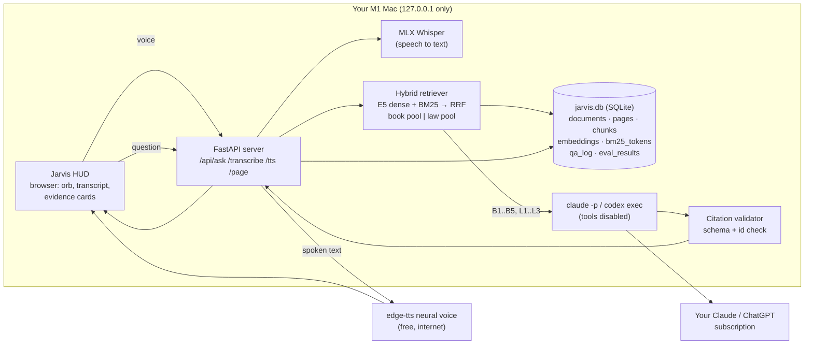
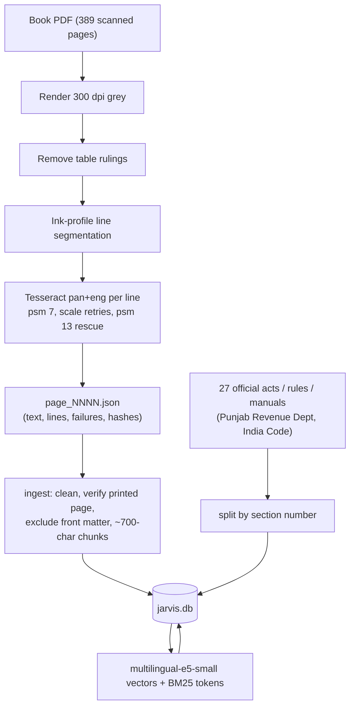

# Architecture

## Offline build pipeline (already run; repeat only to rebuild)

## Modules (`src/revenue_jarvis/`)

| Module | Job |
|---|---|
| `config.py` | Pydantic settings (`JARVIS_*` env vars / `.env`) |
| `ocr/engine.py` | Line-segmenting Tesseract OCR with explicit failure flags |
| `ingest/book.py` | OCR JSON → `pages` + page-linked `chunks`; printed page only when OCR-verified |
| `ingest/laws.py` | Bare acts → section-level `chunks` with source URL and hash |
| `index.py` | E5 embeddings and BM25 tokens stored in SQLite |
| `retrieve.py` | Hybrid search, RRF, separate book/law pools, neighbour context |
| `llm.py` | Claude Code / Codex subprocess backends; strips API-key env vars so only the subscription login is used |
| `answer.py` | Prompt, JSON schema, citation validation, sources-only fallback, Q&A log |
| `voice.py` | MLX Whisper / faster-whisper STT; edge-tts TTS |
| `server.py` | Local web API + static HUD |
| `cli.py` | `jarvis doctor / ocr / build / ask / chat / serve / eval` |
| `evaluate.py` | Recall@5 benchmark with dense-only and BM25-only diagnostics |

## Design decisions

* **Book first, structurally.** Book and law are ranked in separate pools and labelled B/L; the prompt and the validator both treat B ids as primary. A statute can add or conflict, never silently replace.
* **No model-written page numbers.** Citations are rendered from stored metadata, so a model can't invent a page or section.
* **Fail closed.** Bad JSON, an unknown citation id, a timeout or a missing CLI all lead to sources-only, never an unverified answer.
* **One file of state.** All data lives in `data/jarvis.db`; back it up by copying one file.
* **No API billing.** The Claude/Codex subprocesses run with `ANTHROPIC_API_KEY` / `OPENAI_API_KEY` removed from their environment.
